# Edilkamin Control

[](https://hacs.xyz/)


🇫🇷 [Français](#français) · 🇬🇧 [English](#english)

---

## Français

Programmation et pilotage d'un poêle à granulés **Edilkamin** dans Home Assistant, pour un poêle commandé par un **ESP32 en Bluetooth / MQTT** (firmware dérivé de [netmb/Edilkamin_BT](https://github.com/netmb/Edilkamin_BT)).

L'intégration remplace une série d'automatisations : elle applique des programmations horaires (consigne, Marche / Stand-by, puissance, ventilations, silence), respecte les réglages faits à la main, vérifie que le poêle a bien pris les ordres, et envoie un **planning de secours** à l'ESP32 pour que le poêle continue de suivre ses horaires si Home Assistant s'arrête.

Elle n'intervient pas sur le poêle lui-même : tout passe par les entités publiées par le firmware.

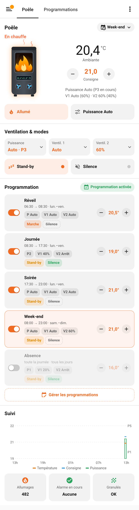

### Fonctions

- **Programmations** (10 au maximum) : nom, début, fin (début = fin : toute la journée, plage pouvant passer minuit), jours de la semaine, consigne, mode Marche ou Stand-by, puissance (Auto ou P1 à P5), ventilation 1, ventilation 2, silence (Relax). En cas de chevauchement, la programmation la plus haute dans la liste l'emporte.
- **Allumage et extinction** : passage hors programmation → programmation, réactivation de la programmation, forçage, et début ou fin de plage quand le poêle est éteint alors que la programmation est en Marche, ou en Stand-by avec une température sous la consigne. Hors programmation, le poêle est éteint (une seule fois, au changement).
- **Dérogation de consigne** : une consigne changée à la main est gardée jusqu'au prochain changement de la programmation (début ou fin de plage, autre programmation appliquée, forçage, passage hors programmation) ou jusqu'à une modification de la consigne en cours.
- **Réglages manuels** : ventilations, puissance, stand-by ou marche/arrêt changés à la main (carte, tableau de bord, application, assistant vocal ou télécommande) ne sont plus renvoyés jusqu'au prochain début ou fin de plage. Bouton « Rendre la main ». Une puissance que le poêle remet de lui-même à « Auto » hors de la phase de marche (arrêt, allumage, extinction), et les valeurs relues au retour de l'ESP32, ne comptent pas comme réglage manuel. La puissance de la programmation est renvoyée dès que le poêle passe en marche.
- **Silence manuel** : Relax activé à la main est prioritaire jusqu'à minuit.
- **Programmation forcée** : une programmation appliquée tout de suite, jusqu'au prochain début ou fin de plage.
- **Si absent** : avec une entité de présence (alarme, personne, zone, interrupteur…), chaque programmation peut être remplacée par une autre quand la maison est vide.
- **Vérification** : 4 minutes après un changement de plage, ce que le poêle renvoie est comparé à la programmation et les ordres perdus sont renvoyés une fois (inscrit dans le journal). Après chaque ordre d'allumage de la programmation, si le poêle est toujours à l'arrêt 4 minutes plus tard (et sous la consigne en Stand-by), l'ordre est renvoyé, 2 fois au plus.
- **Retour de l'ESP32** : si un changement a eu lieu pendant une coupure, tout est renvoyé 1 minute après son retour.
- **Planning de secours** : publié en MQTT (message retenu) à chaque modification.
- **Réservoir de granulés** : heures de chauffe depuis le remplissage, durée du dernier réservoir, durée moyenne, autonomie estimée, seuil d'alerte, réserve signalée par le poêle. Tout est regroupé dans le menu de la tuile Granulés de la carte. Un suivi déjà tenu par une automatisation est repris une fois au premier démarrage, s'il est trouvé : `sensor.…poele…heures_depuis_remplissage`, `input_text.…poele…durees_reservoirs`, `input_number.…poele…dernier_chargement` et `input_number.…poele…seuil_alerte_reservoir` (la reprise est notée dans le journal).
- **[Suivi Stock Pellet](https://github.com/cyclope205/suivi-stock-pellet)** (facultatif, s'il est installé) : le bouton « Réservoir rempli » enregistre la consommation dans Suivi Stock Pellet, une consommation saisie dans Suivi Stock Pellet remet le compteur du réservoir à zéro, et l'autonomie du stock est calculée.
- **Historique des allumages** : les allumages des 3 derniers jours (heure d'allumage, d'arrêt, durée, total et moyenne), d'après le compteur d'allumages du poêle. Affiché par la tuile Allumages de la carte. L'historique déjà tenu par une automatisation (listes « jj/mm hh:mm ; … » en `input_text`) est repris et suivi.
- **Mode observation** : l'intégration calcule tout mais n'envoie rien au poêle ; les ordres sont inscrits dans le journal. Pratique pour la faire tourner à côté d'automatisations existantes avant de basculer.
- **Carte Lovelace** fournie et chargée automatiquement, avec éditeur visuel et choix de l'image du poêle (Edilkamin Bild 9+ par défaut, dessin simple ou image personnelle).
- **Firmware ESP32** installable en un clic depuis le navigateur, puis mis à jour à distance depuis Home Assistant ; page web d'état protégée par mot de passe.

### Prérequis

- Home Assistant 2024.11 ou plus récent (l'icône de l'intégration s'affiche à partir de 2026.3).
- Un ESP32 [Wemos D1 Mini ESP32](https://amzn.eu/d/00g3VR9p) (ou équivalent) près du poêle, avec le firmware Edilkamin Control (voir ci-dessous). Le firmware d'origine [netmb/Edilkamin_BT](https://github.com/netmb/Edilkamin_BT) est aussi pris en charge (non testé), sans planning de secours ni ventilation 2.
- Un serveur MQTT (par exemple l'app Mosquitto de Home Assistant) et l'intégration MQTT : l'ESP32 publie toutes les entités du poêle en MQTT (thermostat, statut, Stand-by ; ventilation 2, Relax et Chrono si disponibles).

### Firmware ESP32

**Installation et mise à jour en un clic** depuis le navigateur (Chrome ou Edge sur ordinateur, ESP32 branché en USB) :

**👉 [https://akoonet-homeassistant.github.io/edilkamin_control/webflash/](https://akoonet-homeassistant.github.io/edilkamin_control/webflash/)**

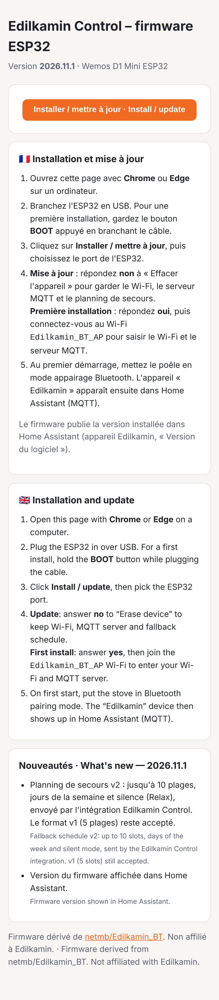

- **Première installation** : garder le bouton **BOOT** de l'ESP32 appuyé en branchant le câble USB, cliquer sur **Installer**, répondre **oui** à « Effacer l'appareil ». Ensuite, se connecter au Wi-Fi `Edilkamin_BT_AP` pour saisir le Wi-Fi de la maison et le serveur MQTT, puis mettre le poêle en mode appairage Bluetooth. L'appareil « Edilkamin » apparaît dans Home Assistant (MQTT).
- **Mise à jour** : depuis le firmware 2026.11.2, le firmware se met à jour **à distance** depuis Home Assistant : **Paramètres → Mises à jour → Firmware de l'ESP32 → Installer** (entité de l'intégration). L'ESP32 télécharge le fichier, vérifie sa somme de contrôle (MD5) et redémarre ; en cas d'échec, il reste sur la version précédente. Un fichier `.bin` peut aussi être envoyé depuis la page web de l'ESP32.
- **Passage à la 2026.11.2** : cette version change la répartition de la mémoire (deux emplacements de programme). Elle s'installe **une dernière fois par USB** en répondant **oui** à « Effacer l'appareil », puis il faut ressaisir le Wi-Fi et le serveur MQTT via le Wi-Fi `Edilkamin_BT_AP`. Le planning de secours est renvoyé par l'intégration.
- **Page web** : `http://<adresse de l'ESP32>/` affiche l'état du poêle et de l'ESP32 (identifiant `admin`). Elle est désactivée tant qu'aucun mot de passe n'est défini (entité « Mot de passe de la page web » de l'appareil Edilkamin ; `-` la désactive). La page est en HTTP : à utiliser sur le réseau local. L'adresse IP est publiée en MQTT (entité « ESP32 adresse IP », lien « Visiter » sur l'appareil).

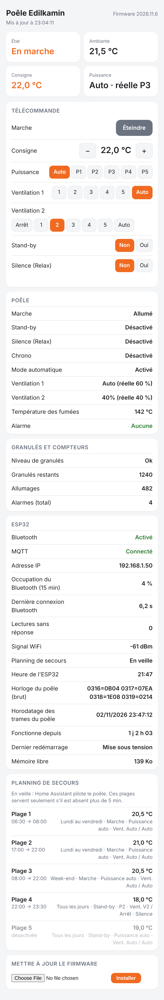

**Sans la page d'installation** (installation manuelle avec [esptool](https://docs.espressif.com/projects/esptool/)), avec les fichiers du dossier [`webflash`](webflash) :

| Fichier | Adresse |
|---|---|
| [`bootloader.bin`](https://github.com/akoonet-homeassistant/edilkamin_control/raw/main/webflash/bootloader.bin) | `0x1000` |
| [`partitions.bin`](https://github.com/akoonet-homeassistant/edilkamin_control/raw/main/webflash/partitions.bin) | `0x8000` |
| [`boot_app0.bin`](https://github.com/akoonet-homeassistant/edilkamin_control/raw/main/webflash/boot_app0.bin) | `0xe000` |
| [`firmware.bin`](https://github.com/akoonet-homeassistant/edilkamin_control/raw/main/webflash/firmware.bin) | `0x10000` |

```bash
# Première installation
esptool.py --chip esp32 erase_flash
esptool.py --chip esp32 write_flash 0x1000 bootloader.bin 0x8000 partitions.bin 0xe000 boot_app0.bin 0x10000 firmware.bin
# Mise à jour (réglages conservés)
esptool.py --chip esp32 write_flash 0x10000 firmware.bin
```

### Installation

1. HACS → menu ⋮ en haut à droite → **Dépôts personnalisés** → dépôt `https://github.com/akoonet-homeassistant/edilkamin_control`, type **Intégration** → **Ajouter**.
2. Installer **Edilkamin Control**, puis redémarrer Home Assistant.
3. Paramètres → Appareils et services → **Ajouter une intégration** → Edilkamin Control.

### Configuration

| | |
|---|---|
| 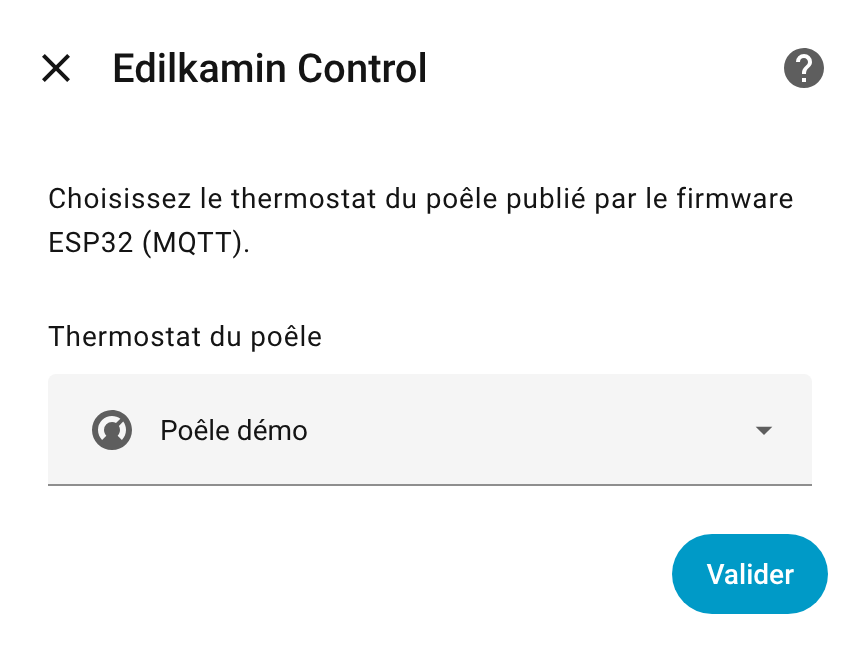 | 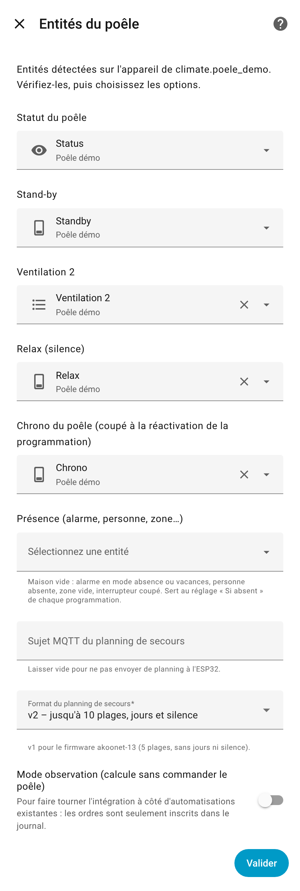 |

1. Choisir le thermostat du poêle.
2. Vérifier les entités trouvées sur le même appareil et choisir les options :
   - **Compteur d'allumages du poêle** : trouvé automatiquement ; sert à l'historique des allumages.
   - **Historique des allumages existant / des arrêts existant** (`input_text`, facultatifs) : listes « jj/mm hh:mm » tenues par une automatisation, la plus récente en premier (« - » = en cours, « ? » = arrêt non vu). Trouvées automatiquement (`input_text.poele_…allumages` et `…arrets`) ; elles alimentent la tuile Allumages dès l'installation.

     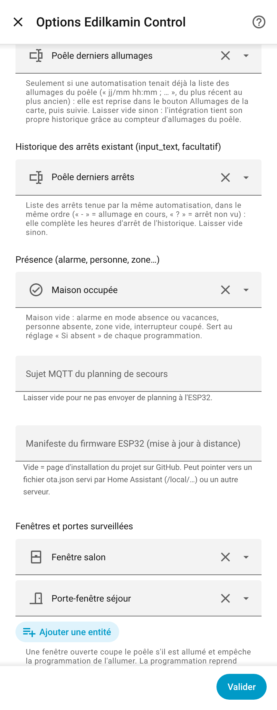
   - **Présence** : maison vide si l'alarme est en mode absence ou vacances, la personne absente, la zone vide ou l'interrupteur coupé.
   - **Sujet MQTT du planning de secours** : proposé d'après l'identifiant de l'ESP32 (`edilkamin/<id>/schedule`). Vide = pas d'envoi.
   - **Manifeste du firmware ESP32** (facultatif) : adresse du fichier `ota.json` de la mise à jour à distance. Vide = page d'installation du projet ; peut pointer vers Home Assistant (`/local/…`) ou un autre serveur.
   - **Format du planning de secours** : `v2` (jusqu'à 10 plages, jours et silence, firmware 2026.11.1 ou plus récent) ou `v1` pour le firmware akoonet-13 (5 plages).
   - **Suivi Stock Pellet** et **sacs versés par remplissage** (affichés seulement si Suivi Stock Pellet est installé).
   - **Mode observation**.

Toutes les options se modifient ensuite par **Configurer**.

### Carte

La carte est chargée par l'intégration, rien à ajouter dans les ressources. Pour l'ajouter : tableau de bord en modification → **+** → onglet **Par carte** → rechercher « Edilkamin ». Si elle n'apparaît pas après une mise à jour, vider le cache du navigateur (Ctrl + F5, ou dans l'application : Paramètres → Application compagnon → Débogage → Réinitialiser le cache du frontend).

```yaml
type: custom:edilkamin-control-card
climate: climate.poele
```

| Thème clair | Thème sombre |
|---|---|
|  | 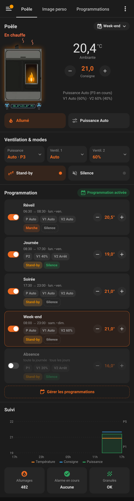 |

- **Thermostat** : cadran comme la commande de thermostat de Home Assistant (température actuelle, arc jusqu'à la consigne, Chauffage / Éteint, boutons − / +).
- **Thermomètre** : un capteur de température choisi dans l'éditeur s'affiche sous le titre (« Salon : 21,6°C ») ; un appui ouvre sa fiche.
- **Image du poêle** : choisie dans l'éditeur visuel de la carte. Les flammes, les ventilateurs et l'écran s'animent selon l'état du poêle.

| Edilkamin Bild 9+ (défaut) | Dessin simple | Image personnelle | Éditeur |
|---|---|---|---|
| 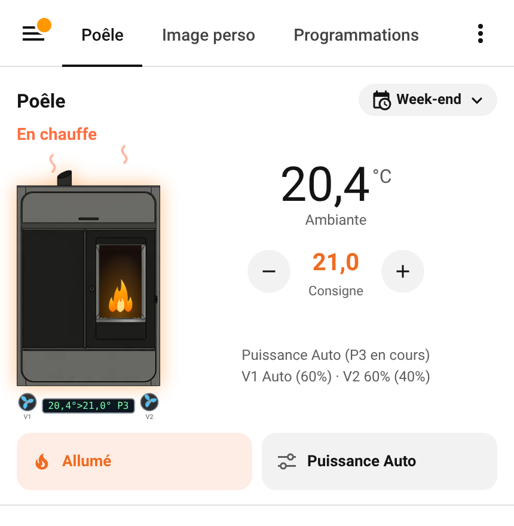 | 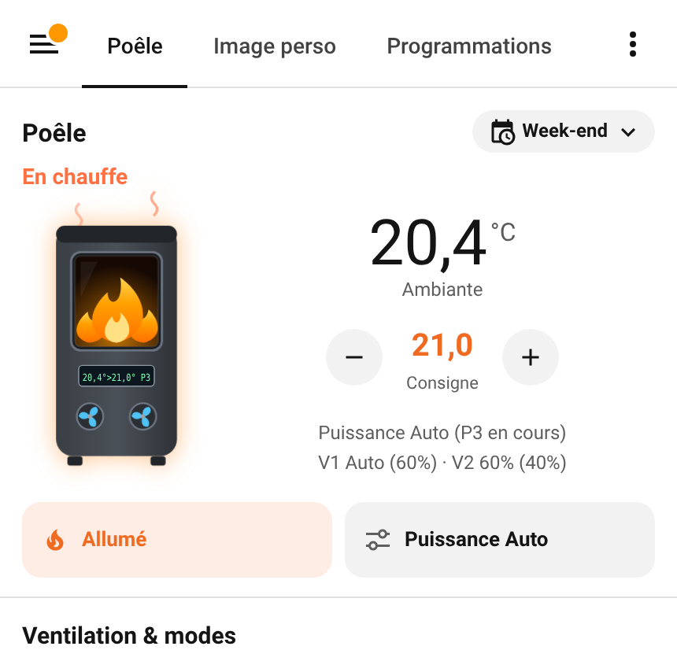 | 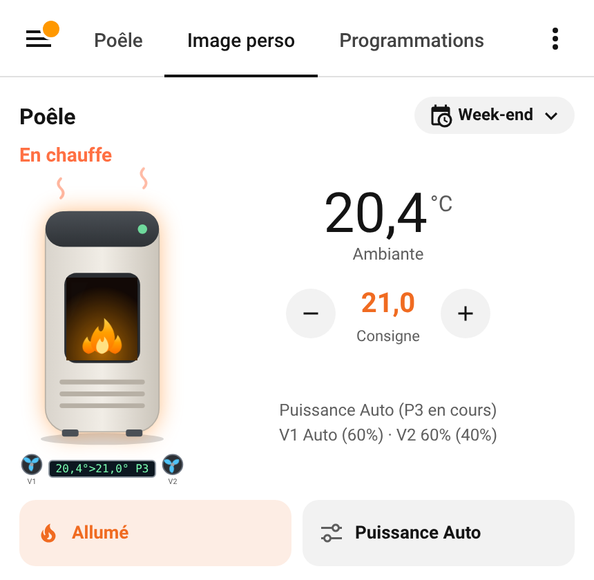 | 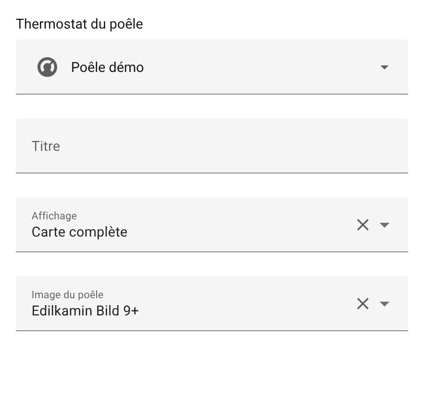 |

- Les étiquettes d'une programmation (Puissance, V1, V2, Stand-by, Silence) changent la valeur à chaque appui.
- **Classement** : dans le menu des programmations, les flèches ▲ ▼ changent l'ordre (la plus haute l'emporte en cas de chevauchement).
- **Heures** : début et fin se règlent avec − / + par pas de 5 minutes (appui long pour défiler) ; un appui sur l'heure ouvre le sélecteur.
- **Tuile Granulés** : un appui ouvre le menu du réservoir, avec le bouton de remplissage (« J'ai versé 1 sac » avec Suivi Stock Pellet).
- **Tuile Allumages** : un appui ouvre les allumages des 3 derniers jours, regroupés par jour.

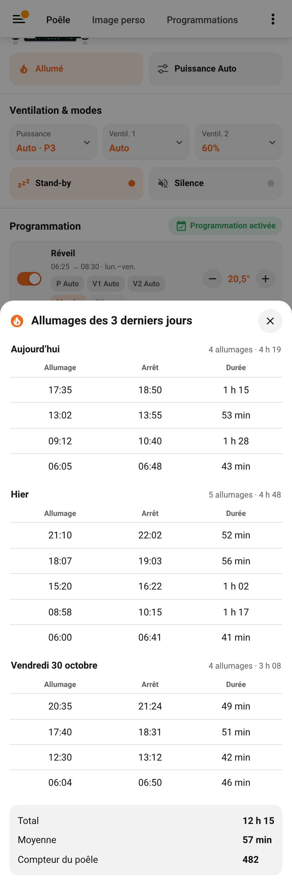

| Classement | Heures | Granulés |
|---|---|---|
| 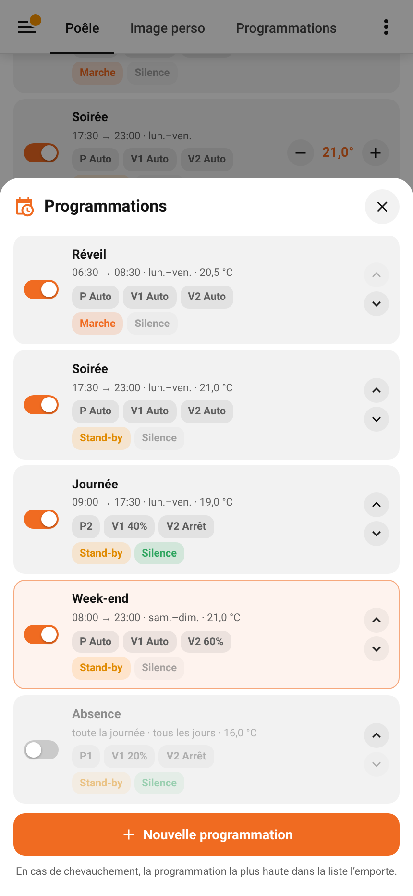 | 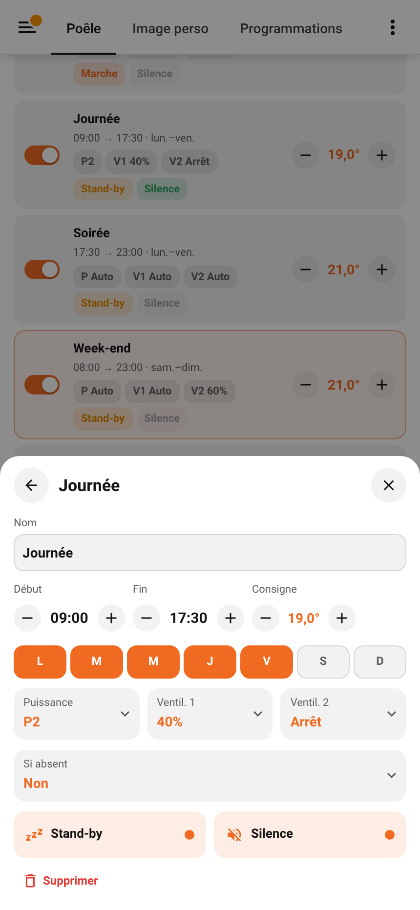 | 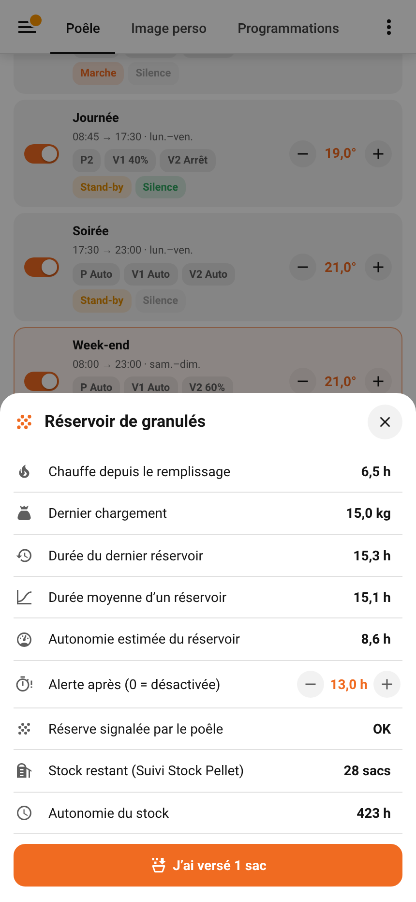 |
- **Gérer les programmations** ouvre le menu : liste, modification, création et suppression.

| Programmations | Modification | Nouvelle |
|---|---|---|
|  |  | 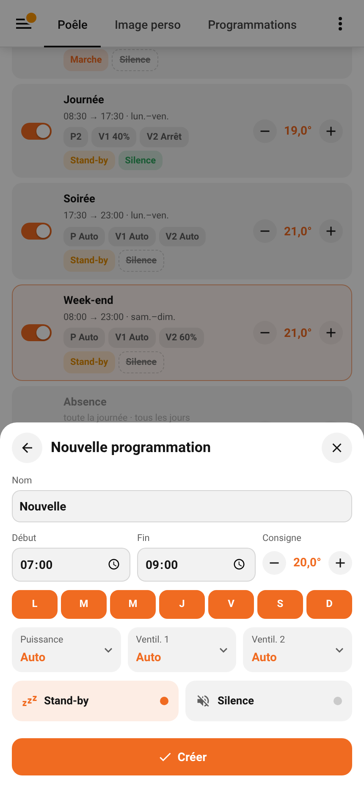 |

Options de la carte :

| Option | Défaut | Rôle |
|---|---|---|
| `climate` | obligatoire | Thermostat du poêle |
| `mode` | `full` | `planning` : affiche seulement le menu des programmations (pour une vue dédiée) |
| `title` | Poêle | Titre |
| `temperature_entity` | — | Thermomètre affiché sous le titre (capteur de température) |
| `temperature_name` | nom de l'entité | Nom affiché devant la température du thermomètre |
| `image` | `bild9` | `bild9` (Edilkamin Bild 9+), `generic` (dessin simple) ou adresse d'une image (ex. `/local/poele.svg`) |
| `image_window` | — | Vitre d'une image personnelle, en % d'un cadre 140 × 212 : `x`, `y`, `width`, `height` |
| `image_calibration` | `false` | Affiche le cadre de la vitre pour la régler |
| `show_header`, `show_modes`, `show_planning`, `show_tracking`, `show_graph` | `true` | Sections affichées |
| `status`, `fan2`, `relax`, `standby`, `real_power`, `real_fan1`, `real_fan2`, `pellet`, `ignitions`, `alarm`, `alarm_label` | détection | Entités du firmware, si la détection automatique ne les trouve pas |

### Entités

Les identifiants dépendent du nom de l'entrée (ici « Poêle »).

**Générales**

| Entité | Rôle |
|---|---|
| `switch.poele_programmation` | Programmation activée |
| `select.poele_programmation_forcee` | Automatique, ou programmation forcée jusqu'au prochain changement de plage |
| `sensor.poele_programmation_en_cours` | Programmation appliquée (attributs `profile`, `substitution`, `occupied`, `resync`, `observe`) |
| `sensor.poele_prochain_changement` | Prochain début ou fin de plage |
| `sensor.poele_dernier_allumage` | Dernier allumage (attribut `history` : allumages des 3 derniers jours, début et arrêt) |
| `update.poele_firmware_de_l_esp32` | Firmware de l'ESP32 : version installée, dernière version, installation à distance (firmware 2026.11.2 ou plus récent ; le sujet MQTT du planning de secours doit être renseigné) |
| `switch.poele_derogation_de_consigne` | Dérogation de consigne (attribut `reference`) |
| `switch.poele_reglages_manuels` | Réglages manuels ; le couper = « Rendre la main » |
| `switch.poele_priorite_silence_manuel` | Silence activé à la main, prioritaire jusqu'à minuit |
| `sensor.poele_chauffe_depuis_le_remplissage` | Heures de chauffe depuis le dernier remplissage |
| `sensor.poele_duree_moyenne_d_un_reservoir` | Moyenne des 10 derniers réservoirs (attribut `durations`) |
| `sensor.poele_autonomie_du_reservoir` | Heures de chauffe restantes estimées (à partir de 2 réservoirs mesurés) |
| `sensor.poele_autonomie_du_stock` | Heures de chauffe permises par le stock (Suivi Stock Pellet) |
| `number.poele_seuil_d_alerte_du_reservoir` | Seuil en heures (0 = désactivé) |
| `binary_sensor.poele_reservoir_bientot_vide` | Seuil dépassé |
| `button.poele_reservoir_rempli` | Remet le compteur du réservoir à zéro |

**Par programmation** (exemple « Soirée », attribut `profile` = position dans la liste)

| Entité | Rôle |
|---|---|
| `switch.poele_soiree_active` | Programmation activée (attribut `days`, 0 = lundi) |
| `text.poele_soiree_nom` | Nom |
| `time.poele_soiree_debut`, `time.poele_soiree_fin` | Début et fin |
| `number.poele_soiree_consigne` | Consigne |
| `select.poele_soiree_mode` | Marche ou Stand-by |
| `select.poele_soiree_puissance` | Auto ou Man. P1 à P5 |
| `select.poele_soiree_ventilation_1`, `select.poele_soiree_ventilation_2` | Ventilations |
| `switch.poele_soiree_silence` | Relax |
| `select.poele_soiree_si_absent` | Programmation appliquée quand la maison est vide (si une présence est configurée) |

### Services

| Service | Rôle |
|---|---|
| `edilkamin_control.add_profile` | Crée une programmation (`name`, `start`, `end`, `days`, `setpoint`, `mode`, `power`, `fan1`, `fan2`, `relax`, `active`) |
| `edilkamin_control.remove_profile` | Supprime la programmation `profile` (position) |
| `edilkamin_control.set_profile_days` | Jours d'une programmation (`days`, 0 = lundi) |
| `edilkamin_control.move_profile` | Change la position d'une programmation (priorité) |
| `edilkamin_control.reservoir_filled` | Remet le compteur du réservoir à zéro |
| `edilkamin_control.publish_schedule` | Envoie tout de suite le planning de secours |

### Planning de secours (MQTT)

Message retenu, QoS 1 : `{"v":2,"p":[{"a":1,"d":390,"f":510,"c":205,"m":0,"pu":0,"v1":6,"v2":6,"r":0,"j":31}, …]}`

`a` active · `d`/`f` minutes depuis minuit · `c` consigne × 10 · `m` 1 = Stand-by · `pu` 0 = Auto, 1 à 5 · `v1` 1 à 5, 6 = Auto · `v2` 0 = arrêt, 1 à 5, 6 = Auto · `r` silence · `j` jours (bit 0 = lundi). Le format `v1` envoie exactement 5 plages sans `r` ni `j`.

### Limites connues

- Le format `v2` du planning de secours demande le firmware Edilkamin Control 2026.11.1 ou plus récent ; avec akoonet-13, choisir `v1`.
- Les programmations existantes faites avec des entrées (input_*) ne sont pas importées automatiquement : utiliser le service `add_profile`.

---

## English

Scheduling and control of an **Edilkamin** pellet stove in Home Assistant, for a stove driven by an **ESP32 over Bluetooth / MQTT** (firmware derived from [netmb/Edilkamin_BT](https://github.com/netmb/Edilkamin_BT)).

The integration replaces a set of automations: it applies time schedules (setpoint, Run / Standby, power, fans, silent mode), respects settings changed by hand, checks that the stove actually took the commands, and sends a **fallback schedule** to the ESP32 so the stove keeps following its times if Home Assistant stops.

It does not touch the stove itself: everything goes through the entities published by the firmware.


### Features

- **Schedules** (up to 10): name, start, end (start = end: all day, slots may cross midnight), days of the week, setpoint, Run or Standby, power (Auto or P1 to P5), fan 1, fan 2, silent (Relax). When schedules overlap, the one highest in the list wins.
- **Turning on and off**: leaving no schedule for a schedule, re-enabling scheduling, forcing, and a slot start or end while the stove is off and the schedule is in Run, or in Standby with the temperature below the setpoint. Outside any schedule the stove is turned off (once, on the change).
- **Setpoint override**: a setpoint changed by hand is kept until the next schedule change (slot start or end, another schedule applied, forcing, leaving the schedules) or a change of the current setpoint.
- **Manual settings**: fans, power, standby or on/off changed by hand (card, dashboard, app, voice assistant or remote) are no longer sent until the next slot start or end. “Give back” button. A power level the stove resets to “Auto” by itself outside the run phase (off, ignition, shutdown), and values read back when the ESP32 reconnects, are not counted as manual settings. The schedule's power is sent again as soon as the stove reaches the run phase.
- **Manual silent mode**: Relax turned on by hand has priority until midnight.
- **Forced schedule**: one schedule applied right away, until the next slot start or end.
- **If away**: with a presence entity (alarm, person, zone, switch…), each schedule can be replaced by another one when the house is empty.
- **Check**: 4 minutes after a slot change, what the stove reports is compared with the schedule and lost commands are sent once more (written to the logbook). After each ignition order from the schedule, if the stove is still off 4 minutes later (and below the setpoint in Standby), the order is sent again, at most twice.
- **ESP32 back online**: if something changed during an outage, everything is sent again 1 minute after it comes back.
- **Fallback schedule**: published over MQTT (retained) on every change.
- **Pellet hopper**: burn hours since refill, last and average hopper duration, estimated autonomy, alert threshold, reserve reported by the stove. Everything is grouped in the menu of the card's Pellets tile. A hopper follow-up already kept by an automation is imported once at first start, when found: `sensor.…poele…heures_depuis_remplissage`, `input_text.…poele…durees_reservoirs`, `input_number.…poele…dernier_chargement` and `input_number.…poele…seuil_alerte_reservoir` (the import is written to the log).
- **[Suivi Stock Pellet](https://github.com/cyclope205/suivi-stock-pellet)** (optional, when installed): the “Hopper refilled” button logs the consumption in Suivi Stock Pellet, a consumption logged in Suivi Stock Pellet resets the hopper counter, and the stock autonomy is computed.
- **Ignition history**: ignitions of the last 3 days (start, stop, duration, total and average), from the stove ignition counter. Shown by the card's Ignitions tile. A history already kept by an automation (« dd/mm hh:mm ; … » lists in `input_text`) is imported and followed.
- **Observe mode**: the integration computes everything but sends nothing to the stove; commands are written to the logbook. Handy to run it next to existing automations before switching over.
- **Lovelace card** included and loaded automatically, with a visual editor and a choice of stove picture (Edilkamin Bild 9+ by default, simple drawing or your own picture).
- **ESP32 firmware** installed in one click from the browser, then updated remotely from Home Assistant; password-protected status web page.

### Requirements

- Home Assistant 2024.11 or newer (the integration icon shows from 2026.3).
- A [Wemos D1 Mini ESP32](https://amzn.eu/d/00g3VR9p) (or equivalent) next to the stove, running the Edilkamin Control firmware (see below). The original [netmb/Edilkamin_BT](https://github.com/netmb/Edilkamin_BT) firmware is also supported (untested), without fallback schedule or fan 2.
- An MQTT broker (for example Home Assistant's Mosquitto app) and the MQTT integration: the ESP32 publishes all stove entities over MQTT (thermostat, status, Standby; fan 2, Relax and Chrono when available).

### ESP32 firmware

**One-click install and update** from the browser (Chrome or Edge on a computer, ESP32 plugged over USB):

**👉 [https://akoonet-homeassistant.github.io/edilkamin_control/webflash/](https://akoonet-homeassistant.github.io/edilkamin_control/webflash/)**

- **First install**: hold the ESP32 **BOOT** button while plugging the USB cable, click **Install**, answer **yes** to “Erase device”. Then join the `Edilkamin_BT_AP` Wi-Fi to enter your home Wi-Fi and MQTT broker, and put the stove in Bluetooth pairing mode. The “Edilkamin” device shows up in Home Assistant (MQTT).
- **Update**: since firmware 2026.11.2, the firmware updates **remotely** from Home Assistant: **Settings → Updates → ESP32 firmware → Install** (integration entity). The ESP32 downloads the file, checks its checksum (MD5) and restarts; on failure it stays on the previous version. A `.bin` file can also be sent from the ESP32 web page.
- **Upgrading to 2026.11.2**: this release changes the memory layout (two program slots). Install it **one last time over USB**, answering **yes** to “Erase device”, then enter Wi-Fi and MQTT again through the `Edilkamin_BT_AP` Wi-Fi. The fallback schedule is sent again by the integration.
- **Web page**: `http://<ESP32 address>/` shows the stove and ESP32 status (user `admin`). It stays disabled until a password is set (“Web page password” entity of the Edilkamin device; `-` disables it). The page uses plain HTTP: for the local network. The IP address is published over MQTT (“ESP32 IP address” entity, “Visit” link on the device).

**Without the install page** (manual install with [esptool](https://docs.espressif.com/projects/esptool/)), using the files of the [`webflash`](webflash) folder:

| File | Address |
|---|---|
| [`bootloader.bin`](https://github.com/akoonet-homeassistant/edilkamin_control/raw/main/webflash/bootloader.bin) | `0x1000` |
| [`partitions.bin`](https://github.com/akoonet-homeassistant/edilkamin_control/raw/main/webflash/partitions.bin) | `0x8000` |
| [`boot_app0.bin`](https://github.com/akoonet-homeassistant/edilkamin_control/raw/main/webflash/boot_app0.bin) | `0xe000` |
| [`firmware.bin`](https://github.com/akoonet-homeassistant/edilkamin_control/raw/main/webflash/firmware.bin) | `0x10000` |

```bash
# First install
esptool.py --chip esp32 erase_flash
esptool.py --chip esp32 write_flash 0x1000 bootloader.bin 0x8000 partitions.bin 0xe000 boot_app0.bin 0x10000 firmware.bin
# Update (settings kept)
esptool.py --chip esp32 write_flash 0x10000 firmware.bin
```

### Installation

1. HACS → ⋮ menu (top right) → **Custom repositories** → repository `https://github.com/akoonet-homeassistant/edilkamin_control`, type **Integration** → **Add**.
2. Install **Edilkamin Control**, then restart Home Assistant.
3. Settings → Devices & services → **Add integration** → Edilkamin Control.

### Configuration

| | |
|---|---|
|  |  |

1. Pick the stove thermostat.
2. Check the entities found on the same device and choose the options:
   - **Stove ignition counter**: found automatically; used for the ignition history.
   - **Existing ignition / stop history** (`input_text`, optional): « dd/mm hh:mm » lists kept by an automation, newest first (« - » = running, « ? » = missed stop). Found automatically (`input_text.poele_…allumages` and `…arrets`); they feed the Ignitions tile as soon as the integration is installed.
   - **Presence**: empty house when the alarm is armed away or vacation, the person is away, the zone is empty or the switch is off.
   - **Fallback schedule MQTT topic**: suggested from the ESP32 identifier (`edilkamin/<id>/schedule`). Empty = nothing sent.
   - **ESP32 firmware manifest** (optional): address of the remote update `ota.json` file. Empty = project install page; can point to Home Assistant (`/local/…`) or another server.
   - **Fallback schedule format**: `v2` (up to 10 slots, days and silent mode, firmware 2026.11.1 or newer) or `v1` for the akoonet-13 firmware (5 slots).
   - **Suivi Stock Pellet** and **bags poured per refill** (shown only when Suivi Stock Pellet is installed).
   - **Observe mode**.

All options can be changed later with **Configure**.

### Card

The card is loaded by the integration, nothing to add to the resources. To add it: dashboard in edit mode → **+** → **By card** tab → search “Edilkamin”. If it does not show up after an update, clear the browser cache (Ctrl + F5, or in the app: Settings → Companion app → Debugging → Reset frontend cache).

```yaml
type: custom:edilkamin-control-card
climate: climate.stove
```

- **Thermostat**: dial like Home Assistant's thermostat control (current temperature, arc up to the setpoint, Heat / Off, − / + buttons).
- **Thermometer**: a temperature sensor chosen in the editor is shown under the title (“Living room: 21.6°C”); a tap opens its details.
- **Stove picture**: chosen in the card's visual editor. Flames, fans and display follow the stove state.
- The tags of a schedule (Power, V1, V2, Standby, Silent) change the value on each tap.
- **Ordering**: in the schedule menu, the ▲ ▼ arrows change the order (the highest wins when schedules overlap).
- **Times**: start and end are set with − / + in 5-minute steps (hold to scroll); tapping the time opens the picker.
- **Pellets tile**: a tap opens the hopper menu, with the refill button (“I poured 1 bag” with Suivi Stock Pellet).
- **Ignitions tile**: a tap opens the ignitions of the last 3 days, grouped by day.
- **Manage schedules** opens the menu: list, edit, create and delete.

Card options:

| Option | Default | Purpose |
|---|---|---|
| `climate` | required | Stove thermostat |
| `mode` | `full` | `planning`: shows only the schedule menu (for a dedicated view) |
| `title` | Stove | Title |
| `temperature_entity` | — | Thermometer shown under the title (temperature sensor) |
| `temperature_name` | entity name | Name shown before the thermometer's temperature |
| `image` | `bild9` | `bild9` (Edilkamin Bild 9+), `generic` (simple drawing) or a picture URL (e.g. `/local/stove.svg`) |
| `image_window` | — | Glass of your own picture, in % of a 140 × 212 frame: `x`, `y`, `width`, `height` |
| `image_calibration` | `false` | Shows the glass frame to adjust it |
| `show_header`, `show_modes`, `show_planning`, `show_tracking`, `show_graph` | `true` | Displayed sections |
| `status`, `fan2`, `relax`, `standby`, `real_power`, `real_fan1`, `real_fan2`, `pellet`, `ignitions`, `alarm`, `alarm_label` | detection | Firmware entities, when automatic detection does not find them |

### Entities

The entity IDs depend on the entry name and on the Home Assistant language (shown here for an English installation and an entry named “Stove”).

**General**

| Entity | Purpose |
|---|---|
| `switch.stove_schedule` | Scheduling enabled |
| `select.stove_forced_schedule` | Automatic, or a schedule forced until the next slot change |
| `sensor.stove_current_schedule` | Applied schedule (attributes `profile`, `substitution`, `occupied`, `resync`, `observe`) |
| `sensor.stove_next_change` | Next slot start or end |
| `sensor.stove_last_ignition` | Last ignition (attribute `history`: ignitions of the last 3 days, start and stop) |
| `update.stove_esp32_firmware` | ESP32 firmware: installed version, latest version, remote install (firmware 2026.11.2 or newer; the fallback schedule MQTT topic must be set) |
| `switch.stove_setpoint_override` | Setpoint override (attribute `reference`) |
| `switch.stove_manual_settings` | Manual settings; turning it off = “Give back” |
| `switch.stove_manual_silent_priority` | Silent mode turned on by hand, priority until midnight |
| `sensor.stove_burn_time_since_refill` | Burn hours since the last refill |
| `sensor.stove_average_hopper_duration` | Average of the last 10 hoppers (attribute `durations`) |
| `sensor.stove_hopper_autonomy` | Estimated remaining burn hours (from 2 measured hoppers) |
| `sensor.stove_stock_autonomy` | Burn hours allowed by the stock (Suivi Stock Pellet) |
| `number.stove_hopper_alert_threshold` | Threshold in hours (0 = off) |
| `binary_sensor.stove_hopper_almost_empty` | Threshold exceeded |
| `button.stove_hopper_refilled` | Resets the hopper counter |

**Per schedule** (example “Evening”, attribute `profile` = position in the list)

| Entity | Purpose |
|---|---|
| `switch.stove_evening_enabled` | Schedule enabled (attribute `days`, 0 = Monday) |
| `text.stove_evening_name` | Name |
| `time.stove_evening_start`, `time.stove_evening_end` | Start and end |
| `number.stove_evening_setpoint` | Setpoint |
| `select.stove_evening_mode` | Run or Standby |
| `select.stove_evening_power` | Auto or Man. P1 to P5 |
| `select.stove_evening_fan_1`, `select.stove_evening_fan_2` | Fans |
| `switch.stove_evening_silent` | Relax |
| `select.stove_evening_if_away` | Schedule applied when the house is empty (when presence is configured) |

### Services

| Service | Purpose |
|---|---|
| `edilkamin_control.add_profile` | Creates a schedule (`name`, `start`, `end`, `days`, `setpoint`, `mode`, `power`, `fan1`, `fan2`, `relax`, `active`) |
| `edilkamin_control.remove_profile` | Removes schedule `profile` (position) |
| `edilkamin_control.set_profile_days` | Days of a schedule (`days`, 0 = Monday) |
| `edilkamin_control.move_profile` | Changes the position of a schedule (priority) |
| `edilkamin_control.reservoir_filled` | Resets the hopper counter |
| `edilkamin_control.publish_schedule` | Sends the fallback schedule now |

### Fallback schedule (MQTT)

Retained message, QoS 1: `{"v":2,"p":[{"a":1,"d":390,"f":510,"c":205,"m":0,"pu":0,"v1":6,"v2":6,"r":0,"j":31}, …]}`

`a` enabled · `d`/`f` minutes since midnight · `c` setpoint × 10 · `m` 1 = Standby · `pu` 0 = Auto, 1 to 5 · `v1` 1 to 5, 6 = Auto · `v2` 0 = off, 1 to 5, 6 = Auto · `r` silent · `j` days (bit 0 = Monday). The `v1` format sends exactly 5 slots without `r` or `j`.

### Known limits

- The `v2` fallback schedule format needs the Edilkamin Control firmware 2026.11.1 or newer; with akoonet-13, choose `v1`.
- Existing schedules built with helpers (input_*) are not imported automatically: use the `add_profile` service.

---

Firmware: fork of [netmb/Edilkamin_BT](https://github.com/netmb/Edilkamin_BT). Not affiliated with Edilkamin. MIT licence.
